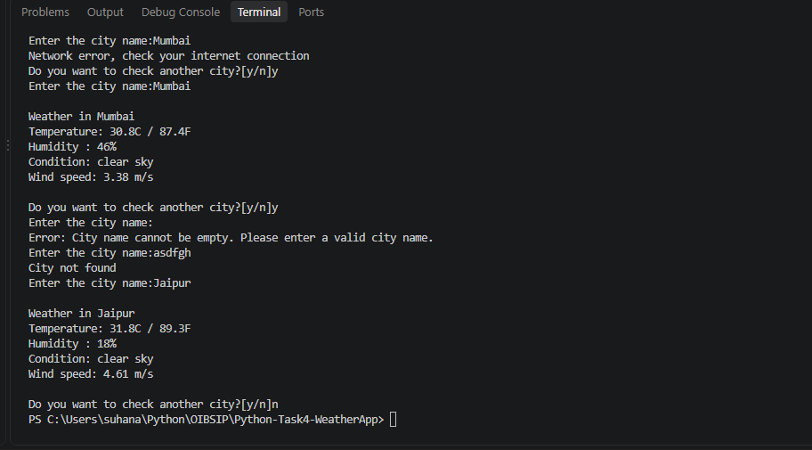

# Weather App

A command-line Python program that fetches and displays real-time weather data for any city using the OpenWeatherMap API.

Task 4 of the Python Programming track, Oasis Infobyte Internship (OIBSIP).

## Features
- Asks for a city name and rejects empty input
- Fetches live data from the OpenWeatherMap API
- Displays:
  - Temperature in °C and °F
  - Humidity percentage
  - Weather condition (for example, clear sky)
  - Wind speed in m/s
- Error handling:
  - City not found
  - Invalid API key
  - Request timeout
  - Network or connection problems
- Option to check another city without restarting

## Technologies Used
- Python 3
- `requests` library
- OpenWeatherMap API (free tier)
- `try/except`, `while` loops and `if/elif/else`

## Setup
1. Install Python 3.
2. Install the library:
   ```
   pip install requests
   ```
3. Create a free API key at [openweathermap.org](https://openweathermap.org).
4. In this folder, create a file named `api_key.txt` and paste only your key inside it. This file is not uploaded to GitHub, so your key stays private.

## How to Run
```
python WeatherApp.py
```

## Sample Output
```
Enter the city name: Mumbai

Weather in Mumbai
Temperature: 30.8°C / 87.4°F
Humidity: 46%
Condition: clear sky
Wind speed: 3.38 m/s

Check another city? (y/n): n
```



## Author
Suhana

GitHub: github.com/suhanasheikh572